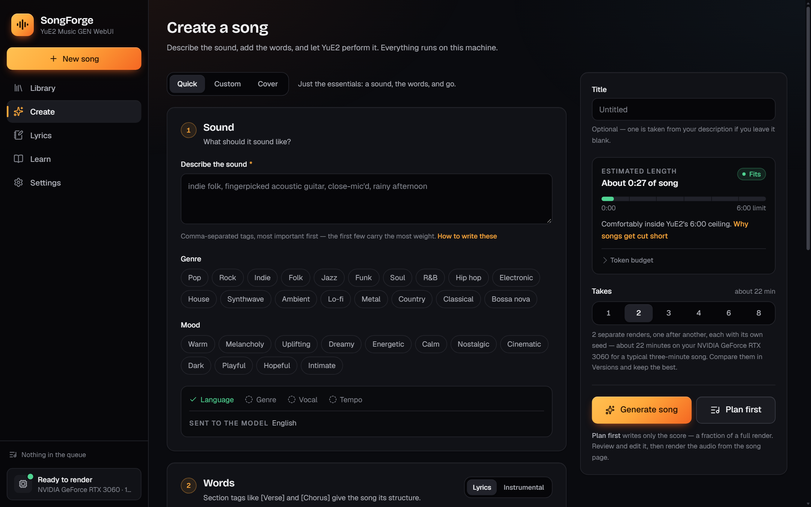
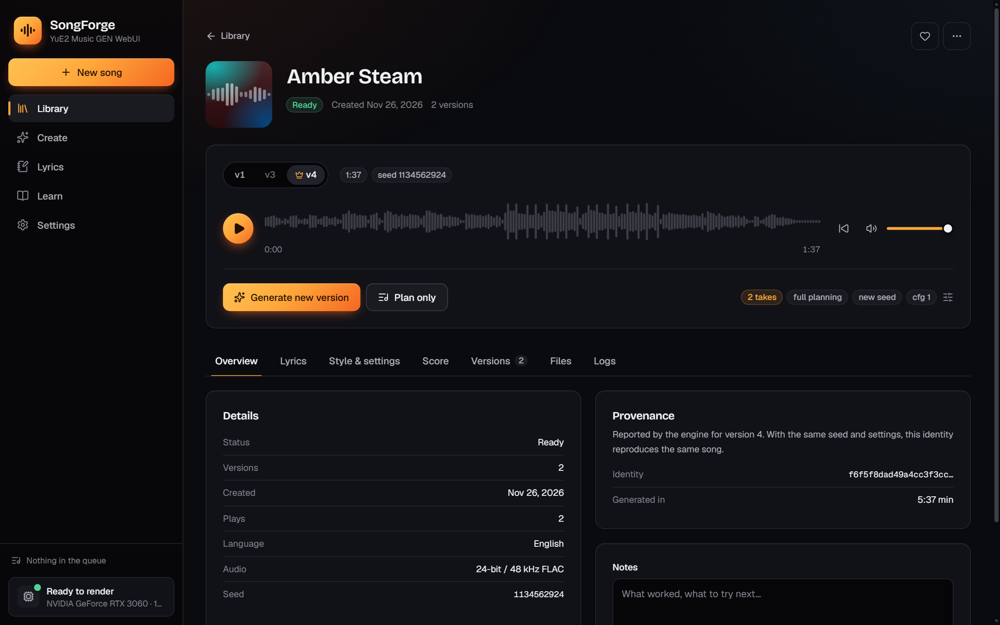
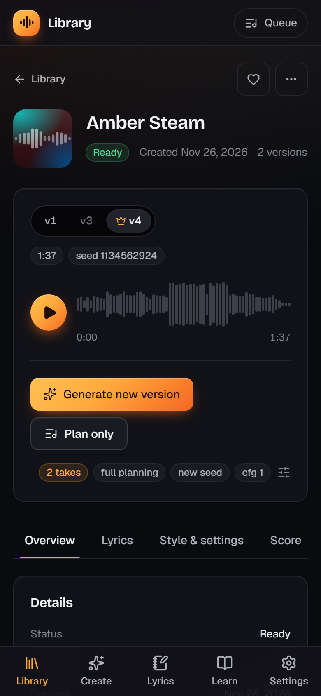

# SongForge | YuE2 Music GEN WebUI

A music studio for the **YuE2** text-to-music model that runs entirely on your
own computer. Describe a sound, add lyrics, and it writes and performs a full
song — vocals, instruments and structure — in your browser. No cloud service, no
account, and nothing you write or generate leaves the machine.

Generation is real: the model writes a symbolic score, renders it to audio, and
saves a 24-bit / 48 kHz FLAC master. A reference run on a 12 GB RTX 3060
produced **72 seconds of music in 220 seconds**, peaking at **9.3 GiB of VRAM**.



<p>
  
  
</p>

> **The model weights are CC BY-NC 4.0 — non-commercial.** This application is
> MIT, which does not extend to the model or to what you make with it. See
> [NOTICE.md](NOTICE.md).

---

## Quick start

**You need:** an NVIDIA graphics card with 12 GB or more (8 GB works for short
songs), [Python 3.12](https://www.python.org/downloads/),
[Node.js LTS](https://nodejs.org), [Git](https://git-scm.com) and about 25 GB of
free disk space. The [full table](#what-you-need) covers Macs, Linux and
everything else.

**1. Get it**

```
git clone https://github.com/damiaan111/SongForge-YuE2-Music-GEN-WebUI
cd SongForge-YuE2-Music-GEN-WebUI
```

**2. Install** — it detects your graphics card, shows what it will download
(about 11 GB) and installs nothing until you agree.

| Windows | macOS and Linux |
| --- | --- |
| double-click **`setup.bat`** | `./setup.sh` |

**3. Start**

| Windows | macOS and Linux |
| --- | --- |
| double-click **`start.bat`** | `./start.sh` |

A terminal window opens, shows the address — `http://localhost:3333` — and opens
it in your browser. **That window is the app:** keep it open while you use
SongForge, and close it (or press Ctrl+C) to stop. Nothing keeps running in the
background.

---

## What it does

- **Library** — every song, with search, filters, tags, favourites, sorting,
  multi-select archive/delete/export, and a player that keeps playing while you
  move around the app.
- **Create** — a Quick mode (describe it, add lyrics, go), a Custom mode with the
  model's real controls (planning mode, seed, guidance scale, language, vocal
  preference, output formats), and a Cover mode that takes an ABC melody and
  plans the melody only, as YuE2's own guidance recommends.
- **Guided prompting** — the style box composes comma-separated tags in the order
  YuE2 was trained on, with genre, mood and "leave out" chips, tempo and key
  hints, and a checklist of the four tags that most change the result. The
  lyrics editor flags what costs you words: shorthand like `x2`, sections over
  six lines, production notes, and repeats whose syllable counts have drifted.
- **Length estimate** — before you spend GPU time, an estimate of sung length
  against YuE2's six-minute ceiling and of the prompt against its 24,576-token
  context, so an overlong lyric is caught at the keyboard rather than in the
  render.
- **Learn** — in-app guidance for this model: writing style tags, writing lyrics
  it will actually sing, and why songs get cut short, plus a troubleshooting
  table keyed to the warnings the app emits. It works offline.
- **Song workspace** — Overview, Lyrics, Style, **Score**, Versions, Files, Logs.
  Completed versions are immutable; edits are drafts until you render again.
- **Plan → edit → render** — YuE2 can write only the score first (about 86 s
  instead of 220 s), let you edit the ABC by hand, then render audio from it.
  This is the feature no hosted service offers.
- **Reproducibility** — every version records its seed, planning mode, guidance
  scale, sampling overrides, model and decoder checksums, and the exact command
  line. **Reuse this take** in Versions puts all of it back into the editor.
- **Several takes per Generate** — two by default, up to 8, each with its own seed,
  compared side by side. Best-of-two is YuE2's own published baseline, so a
  single take is the model at its worst rather than its average. They run one
  after another; budget about 3–4 minutes each on an RTX 3060.
- **Sampling controls** — score and audio sampling (temperature, top-p, top-k,
  repetition penalty, token limits) and synthesis steps, with YuE2's defaults
  shown in every blank field.
- **Lyrics writer (optional)** — a local language model through Ollama writes or
  revises lyrics in any language, sized to a target length, from a **Write for
  me** button on every lyrics box or the **Lyrics** page. Setup asks whether you
  want it; SongForge is complete without it.
- **Settings** — the engine, a self-test that loads nothing onto the GPU, song
  defaults, appearance (dark, light or system), and the expert options kept
  out of the way under Advanced.

It works on a phone, a tablet and an ultrawide monitor alike.

### What it deliberately does not do

These are model limits, not missing features, so no control pretends otherwise:

| Not available | Why |
| --- | --- |
| Stem separation | The pipeline decodes one stereo mix; there is no separation model. |
| Extend / continue a song | Conditioning takes score tokens, not audio. |
| Remix from an uploaded recording | There is no audio input. A cover starts from an ABC score. |
| MIDI export | The symbolic output is ABC text. `score.abc` is downloadable. |
| Voice cloning / personas | The request has no speaker or reference-audio field. |
| A song-length dial | Length follows the lyrics and stops when the model ends the piece. |
| Cover art | Not generated. Each song gets a colour-and-waveform tile drawn from its id, so the library can be scanned at a glance; nothing is stored or fetched. |

Instrumental mode works, but as a prompt directive plus empty lyrics rather than
a model flag — the UI says so where you turn it on.

---

## What you need

| Requirement | Notes |
| --- | --- |
| Windows 10 22H2 or newer, Linux, or macOS on Apple Silicon | See the support table below for what has been tested where. |
| Python 3.12 (3.13 also works) | Setup finds it. Older and newer versions are refused, because YuE2's dependencies are not published for them. It can sit beside any other Python you have. |
| Node.js 20 LTS or newer | For the web app. |
| Git | To download and update SongForge. |
| About 25 GB free disk | 11 GB is downloaded (PyTorch 3 GB, model 6.8 GB, decoder 0.5 GB, the rest small); installed it comes to roughly 17 GB, and songs accumulate. The optional lyrics writer adds 1–9 GB. |
| FFmpeg | Optional. Only for MP3/WAV exports; the FLAC master never needs it. |

**Graphics.** Setup detects what you have and installs the matching PyTorch; it
never guesses. With more than one NVIDIA card it uses the one with the most
memory.

| Hardware | Status |
| --- | --- |
| NVIDIA, 12 GB or more — Windows | **Tested end to end** on an RTX 3060 12 GB: clean install, render, every screen. 24 GB is what YuE2 upstream asks for; 12 GB works with AR offload and memory-efficient attention, which setup switches on for you. |
| NVIDIA, 12 GB or more — Linux | Same code path, covered by the automated tests on every change, but no render has been verified on a physical Linux machine. Reports welcome. |
| NVIDIA, 8–10 GB | Installs and runs; expect out-of-memory errors on longer songs. Keep lyrics short. |
| NVIDIA, compute 8.9+ (Ada, Hopper, Blackwell) | Also gets fp8 quantization, which older cards cannot run at all. |
| Apple Silicon (M-series) | **Experimental.** Setup installs the Metal build and the start script is the same one Linux uses, but nothing has been rendered on a Mac by the maintainers. 16 GB of memory is a practical minimum. |
| AMD on Linux (ROCm) | PyTorch exists; untested here. |
| AMD or Intel graphics on Windows | Not supported by PyTorch. Setup says so and offers the CPU, which takes hours per song. |
| No graphics card | Installs, and the **Simulation** engine lets you explore the whole app with placeholder audio. Real songs on a CPU take hours, not minutes. |

**Memory on Windows.** Loading the model briefly needs more memory than a 16 GB
PC has free. Setup checks this and tells you if a larger page file is needed;
how to set one is under [Troubleshooting](#troubleshooting).

---

## Install

Double-click **`setup.bat`** on Windows, or run `./setup.sh` on macOS and Linux.
(From a terminal on Windows, `.\setup.bat` or `.\setup.ps1` do the same.)

Setup finds Python, detects your hardware, and first asks one question in plain
words — whether you want the optional lyrics writer. Then it shows a menu:

```
SongForge setup
------------------------------------------------------------------------
Detected: NVIDIA GeForce RTX 4070, 12 GB, compute 8.9, driver 566.03 - Windows
PyTorch:  CUDA 12.8

  [x]  1  Python backend environment                   120 MB  required
  [x]  2  Node.js frontend packages                    520 MB  required
  [x]  3  PyTorch 2.10.0 for CUDA 12.8                 3.0 GB  required
  [x]  4  YuE2 inference package                         2 MB  required
  [x]  5  YuE2-3B weights (m-a-p/YuE2-3B)              6.8 GB  required  CC BY-NC 4.0
  [x]  6  YuE2 VAE weights (m-a-p/YuE2-Vae)            506 MB  required  CC BY-NC 4.0
  [ ]  7  Lyrics writer (gemma4:12b via Ollama)        9.0 GB  optional
  [ ]  8  FFmpeg                                        90 MB  optional

To download: 10.9 GB   Free on this drive: 212.4 GB

------------------------------------------------------------------------
[1-9] toggle   [a] all   [n] none   [Enter] install   [q] quit
```

Every line is a checkbox, including the required ones. Nothing is downloaded
until you press Enter, and the non-commercial weight licence is shown and
acknowledged before any weight is fetched. On a typical connection the whole
install takes 15–30 minutes.

**It is safe to run again.** Anything already installed shows as `done` and is
skipped; an interrupted download continues from where it stopped; a model file
that is the wrong size is treated as missing and fetched again.

**What makes it repeatable.** The backend installs the exact package versions
its tests passed on (`app/backend/constraints.txt`), the web app installs from
its lockfile, and the model is downloaded at one exact, recorded revision. The
model repository also carries the inference code that setup installs; that file
is installed only if its SHA-256 matches the one recorded in this repository.
A push upstream cannot quietly change what a new install gets.

**Useful flags** — the same on every platform (`setup.bat --yes`, `./setup.sh --yes`):

| Flag | Does |
| --- | --- |
| `--yes` | Install everything required without asking. For scripts and unattended installs. Never installs the lyrics writer by itself. |
| `--yes --with-lyrics` | The same, plus the optional lyrics writer (Ollama must already be installed). |
| `--no-lyrics` | Skip the question about the lyrics writer. |
| `--detect` | Print the detected GPU, the chosen PyTorch build and the settings derived from it, as JSON. Include this in bug reports. |
| `--only=backend,frontend` | Install just those. Enough to try the app with the Simulation engine, without the model. |
| `--dry-run` | Print every command that would run, without running any of it. |

**What it writes.** Everything lands under `runtime/`, which is gitignored in
full: two virtual environments, the weights, the database, the logs and your
songs. Setup also writes `runtime/hardware-profile.json`, which the backend
reads the first time it starts to fill in the model paths and a memory budget
that suits your card — so there is nothing to type in Settings afterwards.
Deleting `runtime/` uninstalls everything except the source itself.

Installing by hand instead: [docs/manual-install.md](docs/manual-install.md).

**Verify before the first render** — in the app, **Settings → Check that it
works → Run test**. It checks the engine, the graphics card, the memory budget
and the model files' checksums, and loads nothing onto the GPU. The same check
from a terminal on Windows: `.\scripts\Test-YuE2Runner.ps1`.

---

## Starting and stopping

Double-click **`start.bat`** on Windows, or run `./start.sh` on macOS and Linux.

```
  SongForge
  ---------
  Starting the engine ...
  Starting the web app ...

  SongForge is running.

    Open it here:    http://localhost:3333
    Only this computer can open it. Start with -Lan to share it on your network.
    Lyrics writer:   not installed (optional)
    Logs:            D:\SongForge\runtime\logs

  Keep this window open while you use SongForge.
  Press Ctrl+C here, or close the window, to stop it.

  [21:04:12] Rendering a song ...
  [21:10:47] Done. Ready for the next one.
```

- The terminal stays open for as long as SongForge runs, and shows when a render
  starts and finishes. **There is no background service and nothing starts with
  your computer.**
- Closing the window, or Ctrl+C, stops the app and any render in progress. The
  render's logs are kept, and the song page offers to retry it.
- It refuses to start a second copy, and tells you where the first one is.
- If something was left behind after a crash: `scripts\Stop-SongForge.ps1`
  (Windows) or `./scripts/stop-songforge.sh`.

| Option | Windows | macOS / Linux |
| --- | --- | --- |
| Share on your home network | `start.bat -Lan` | `./start.sh --lan` |
| Do not open the browser | `start.bat -NoBrowser` | `./start.sh --no-browser` |
| Another port | `start.bat -Port 8080` | `PORT=8080 ./start.sh` |
| Another engine port (if 3334 is taken) | `start.bat -BackendPort 3344` | `BACKEND_PORT=3344 ./start.sh` |

A desktop shortcut on Windows: `.\scripts\Create-DesktopShortcut.ps1`.

---

## Lyrics writer (optional)

**SongForge works without this.** You can write or paste lyrics into the editor
and never install any of it. It is offered because having a model write a first
draft to the right shape — four to six lines a section, repeats written out in
full — saves more time than it costs.

When it is there, it runs locally through
[Ollama](https://github.com/ollama/ollama), so nothing is sent to a cloud
service. Setup picks a Gemma model sized to your card: 12B on 11 GB or more,
4B on a smaller one, 1B below that.

**Adding it**

Setup asks: *Install the lyrics writer? [y/N]*. Say yes and it downloads the
model. If Ollama itself is missing, setup offers to install it for you where it
safely can (with `winget` on Windows, Homebrew on a Mac) and otherwise tells you
the one command to run. Say no and nothing is installed; the question is not
asked again until you run setup yourself.

To add it later, run setup again and answer yes — or, with Ollama installed,
`setup.bat --only=lyrics` / `./setup.sh --only=lyrics`.

When it is not installed, the app says so in one quiet line where the writer
would be. Nothing errors, and no other feature is affected.

**Using it**

- **Write for me** on any lyrics box opens the writer. Describe what the song is
  about, pick a language and a length, and press Write lyrics. The text streams
  in; **Use these lyrics** puts it in the editor, and your previous lyrics are
  kept in History.
- **Revise** mode changes the lyrics already in the editor: "make the chorus more
  hopeful", "add a bridge".
- **Write lyrics & render song** does both in one step. If the writer notices
  anything off about the lyrics it produced, it stops and shows them instead of
  rendering.
- The **Lyrics** page is a separate workspace for trying ideas, with earlier
  results kept in the browser, and **Open in Create** or **Render as a new song**.

**Sharing the graphics card with YuE2**

The two cannot run at the same time on a 12 GB card: gemma4:12b takes about
7.5 GB, and YuE2 needs about 10.8 GB while rendering. SongForge handles this:

- The writer is unavailable while a song is rendering or queued, and says so.
- Before every render, SongForge unloads the lyrics model and waits until the
  GPU is free. It takes about a second.
- Opening the writer loads the model in the background when the GPU is free, so
  the ~17-second load usually happens while you type. The first load after
  installing or rebooting can take up to two minutes.

Measured on the RTX 3060: a three-minute song's lyrics take about 13 seconds to
write once the model is loaded, and the requested length lands within about 5%.

## Using it from another device

By default only the computer SongForge runs on can open it. To use it from a
phone or another computer **on your own network**, start it with `-Lan`
(`--lan` on macOS and Linux). The terminal then prints a second address:

```
    Open it here:    http://localhost:3333
    Other devices:   http://192.168.1.42:3333
```

Open that second address on the other device. If it cannot connect, the
computer's firewall is the usual reason — Windows asks about it the first time;
allow it for **private networks only**. To add the rule by hand - the one
step in this README that needs an administrator PowerShell, because Windows
requires it for firewall rules - replace the range with your own network's:

```powershell
New-NetFirewallRule -DisplayName "SongForge" -Direction Inbound -Action Allow -Protocol TCP -LocalPort 3333 -RemoteAddress 192.168.1.0/24
```

SongForge has no accounts and no password: anyone who can reach the port can
use it. Only the web app listens on the network; the API binds to `127.0.0.1`
and is reached through the web app's proxy. **Do not port-forward it and do not
put it behind a tunnel.**

While it is shared, the settings that decide which program runs and which model
is loaded (Settings -> Advanced, and the model location) are locked. To change
them, start SongForge without `-Lan`, change them on the computer itself, and
share it again. Everything else - songs, defaults, appearance - works as usual.

---

## Model configuration

Everything below lives in **Settings**, and each field explains itself there.

| Setting | Sensible value | Why |
| --- | --- | --- |
| Model | `runtime\models\YuE2-3B` | Local path, or a Hugging Face id. |
| Audio decoder | `standard` | `legacy` scores higher on musicality benchmarks; `standard` sounds cleaner. |
| GPU index | `0` | First CUDA device. |
| VRAM budget | `12` GiB | Your card's size. YuE2 caps itself at budget − 2 GiB, so on a 12 GB card this allows 10 GiB. A lower number only makes out-of-memory errors likelier. |
| Attention backend | `torch-eager` | Works everywhere and is what setup chooses. Plain `torch` needs FlashAttention, which has no Windows build. |
| Quantization | `none` | `fp8` needs compute capability 8.9+; an RTX 3060 is 8.6. |
| Offline mode | on, after the first download | Prevents any Hugging Face lookup. |

The **command template** builds the `yue2` command line from documented
placeholders. Only the `yue2` CLI and its own flags are accepted — the field is
constrained on purpose, because Settings is reachable by anyone who can reach
the app, and a free-form executable plus free-form arguments would be a remote
code execution hole. Arguments are always passed as a list; no shell is
involved.

---

## Backup

The library is two folders inside `runtime`:

```
runtime\projects\    one folder per song: lyrics, style, score, every version's audio and logs
runtime\database\    songforge.db - titles, tags, versions, job history
```

Stop the app, copy both, and you have everything. Restoring is copying them
back. Weights in `runtime\models` are re-downloadable and do not need backing
up.

A single song can be exported at any time from its **Files** tab as a ZIP
containing the audio, score, request and logs. To export several, select them
in the Library and choose **Export ZIP**; each song gets its own folder.

---

## Updating

Close the SongForge window, then:

```
git pull
```

and run setup again (`setup.bat`, or `./setup.sh`). It reinstalls only what
changed - the web app is rebuilt, the model is left alone - and then start
SongForge as usual.

The database migrates itself on startup: columns added by a newer version are
added to your existing database. The migration only ever adds; it never drops or
rewrites data. To update the model package, install
the new wheel into `runtime\venv-yue2` and re-run `Test-YuE2Runner.ps1` — the
weight checksums are re-verified, and Settings will report any mismatch.

---

## Troubleshooting

**Double-clicking `setup.bat` flashes a window that closes at once**

Python or Node.js is missing. Open a terminal in the SongForge folder and run
`.\setup.bat` from there to read the message; it names what to install.
Python 3.12: `winget install Python.Python.3.12`. Node.js:
`winget install OpenJS.NodeJS.LTS`. Open a **new** terminal afterwards, so the
newly installed program is found.

**`setup.ps1 cannot be loaded because running scripts is disabled on this system`**

That is Windows' default for PowerShell scripts. Use **`setup.bat`** and
**`start.bat`** instead: they run the same scripts with that check relaxed for
that one run only, and change nothing system-wide.

**Setup says Python is too new, or too old**

YuE2's dependencies are pinned to exact versions that are published for Python
3.12 and 3.13 only. Install 3.12 beside whatever you have - it does not replace
it - and run setup again; the launcher finds the right one by itself.

**Setup stops while downloading PyTorch, or ends with `WinError 32`**

The CUDA build is a 2.9 GB file, and on a connection that drops it is the step
that fails. Setup fetches it to `runtime/downloads` and continues where it
stopped, so the first thing to try is **running setup again** — it picks up the
part that already arrived instead of starting over.

If it stops at the same point every time, something is cutting the transfer:

- Exclude `runtime\downloads` from your virus scanner. `WinError 32 - the
  process cannot access the file because it is being used by another process`
  is a scanner holding the file open while setup tries to finish with it.
- Or download the wheel yourself, put it in `runtime\downloads`, and run setup
  again. It checks the file against the checksum the index publishes and skips
  the download when it matches. The exact URL is printed in the error, and
  `docs/manual-install.md` has a `curl` command that resumes.

**Setup says a revision was not found, or the inference wheel "does not match"**

Setup downloads the model at one exact revision and installs the model's
inference code only if its checksum matches the one recorded here. "Revision
not found" means the model's authors rewrote their repository: update SongForge
(`git pull`, then setup again), and if there is no update yet, set the
environment variable `SONGFORGE_UNPINNED_MODEL=1` and run setup again to
download their newest files instead. A wheel that "does not match" is never
installed and has no override - run setup again, and if it repeats, please
[report it](SECURITY.md).

**The model fails to load, or Windows reports it is out of memory**

Set a large pagefile on the drive holding the runtime folder. Loading a 3B model
briefly needs far more host RAM than the resident footprint suggests, and
Windows will not grow the pagefile fast enough on its own.

System → About → Advanced system settings → Performance → Advanced → Virtual
memory → uncheck automatic → select the drive → Custom size → 32768 / 32768 MB
→ Set → reboot.

**`FlashAttention is not available`, or a crash immediately after model load**

The attention backend is set to `torch`. Change it to `torch-eager` in Settings.
There is no Windows build of FlashAttention; `torch-eager` is the working
configuration, not a workaround with a cost.

**The lyrics writer says it is not set up**

It is optional, and that message is the whole of the problem: SongForge works
without it. To add it, run setup again and answer yes to the lyrics question.
If you installed Ollama yourself, SongForge starts it when it is not already
running (the terminal shows `Lyrics writer: running`), and uses whichever
models that Ollama has; the model named in **Settings → Lyrics writer** must be
one of them. The newest `runtime\logs\ollama-*.log` has the details when it
does not start.

**How long can a song be, and how long does it take?**

Measured on the reference RTX 3060 12 GB with the budget at 12 GiB and
memory-efficient attention on (both defaults):

| Song | Audio | Generation time | GPU peak (whole card) |
| --- | --- | --- | --- |
| 2 short sections | 0:44 | 3 min | 9.0 GB |
| Instrumental, no lyrics | 3:51 | 11.7 min | 10.8 GB |
| 13 sections | 3:55 | 11.7 min | 10.8 GB |
| 17 sections | 4:55 | 16.3 min | 10.8 GB |
| 21 sections | 5:31 | 19.3 min | 10.8 GB |

Memory stays flat as songs get longer; time grows a little faster than length.
Length follows the lyrics - roughly 27 seconds plus one second per 8.5
characters of lyric - and the Create page shows that estimate as you type. The
audio token limit defaults to 9,000 (about six minutes); for anything longer,
raise **Audio sampling → Max tokens**, or the song is cut short and marked so.

**Songs past about two minutes fail with "OutOfMemoryError"**

Check that **Memory-efficient attention** is on in Settings. Without it, YuE2's
attention on Windows needs memory that grows with the square of the song's
length: PyTorch has no FlashAttention build for Windows, and its
memory-efficient kernel refuses YuE2's grouped attention heads, so every call
falls back to one that builds the full attention matrix - 5.2 GiB for a single
call at 6,000 tokens. SongForge's launcher expands the heads first so the
efficient kernel is used (0.02 GiB for the same call); output differs only by
rounding. Nothing in the installed yue2 package is modified.

**A song fails with "OutOfMemoryError"**

YuE2 limits itself to the memory budget minus 2 GiB. Set the budget to your
card's size in Settings (12 on a 12 GB card, which allows 10 GiB); a lower
budget only lowers that limit. Longer pieces need more memory. An instrumental
with no lyrics tends to plan a much longer score (one real run planned 2,475 score
tokens against 525 for a two-verse song), so lowering **Score sampling → Max
tokens** keeps it within reach. Windows "shared GPU memory" is not used: the
limit is enforced before it could be, and spilling to system RAM over PCIe would
be many times slower anyway.

**`fp8 requires compute capability 8.9`**

Set Quantization to `none`. An RTX 3060 is compute 8.6.

**Generate is rejected because lyrics are required**

YuE2 always needs a lyric block, even in Quick mode — a prompt alone is not a
valid request. For an instrumental piece, turn on the instrumental toggle, which
sends an instrumental directive and allows the lyrics to be empty.

**The sampling controls say they are unavailable**

Your command template predates them. In **Settings → Command template**, press
**Reset**. The controls need the `{request_file}` and `{config_file}`
placeholders, and resume needs `{resume}`; SongForge refuses overrides rather
than silently ignoring them.

**The Score tab is empty**

Planning mode was `off` for that version. That mode skips the symbolic stage
entirely — it is roughly 15 % faster and produces no score to edit. Use `full`
or `melody` if you want an editable score.

**A version says the song was cut short**

The model hit its token ceiling before finishing. Shorten the lyrics, or raise
the audio token limit in the advanced sampling controls. The default ceiling is
about six minutes of audio.

**MP3 or WAV downloads are missing**

FFmpeg is not on PATH. The FLAC master is always written by the model itself and
is unaffected; install FFmpeg and re-render, or just download the FLAC.

**The page says it cannot reach the SongForge backend**

The SongForge terminal window was closed, or the engine stopped. Look at that
window: it says what happened and where the log is. Start it again with
`start.bat` / `./start.sh`; the page reconnects by itself. If it refuses to
start because a copy is "already running" that you cannot find,
`scripts\Stop-SongForge.ps1` (or `./scripts/stop-songforge.sh`) clears it.

**Port 3333 is already in use**

Another program has it. Start on a different one: `start.bat -Port 8080`, or
`PORT=8080 ./start.sh`.

**A job is stuck as "interrupted" after a crash or power cut**

That status is correct and deliberate: the backend cannot know whether the run
finished, so it does not claim it did. In the song's **Logs** tab:

- **Recover finished run** — if YuE2 had already finished before SongForge
  stopped, this records that result in seconds. YuE2 re-checks it against the
  request, settings and weight checksums, and SongForge tells you plainly when
  there is nothing to recover. YuE2 cannot continue a half-finished run.
- **Retry with the same settings** — renders it again as a new version.

The logs and any partial output are kept either way.

**Another device cannot reach the app**

SongForge only listens on the network when started with `-Lan` (`--lan`).
Then confirm the firewall allows it (`Get-NetFirewallRule -DisplayName
SongForge` on Windows), that both devices are on the same network, and that
you are using the "Other devices" address the terminal prints rather than
`localhost`.

---

## Licences

Two of them, and the difference matters.

- **This repository's code is MIT.** Fork it, change it, ship it. See
  [LICENSE](LICENSE).
- **The YuE2 weights are CC BY-NC 4.0 — non-commercial.** They are not
  redistributed here; setup downloads them from
  [m-a-p/YuE2-3B](https://huggingface.co/m-a-p/YuE2-3B) and
  [m-a-p/YuE2-Vae](https://huggingface.co/m-a-p/YuE2-Vae) at your request, and
  shows the licence before it does.

The MIT licence on this interface grants you nothing in respect of the model or
of what you generate with it. If you plan to release, sell or monetise a song,
read [NOTICE.md](NOTICE.md) first.

Contributions are welcome: [CONTRIBUTING.md](CONTRIBUTING.md).

---

## Development

```
setup.bat --only=backend,frontend        # or ./setup.sh --only=backend,frontend
```

installs just the app, without the model. Then, in two terminals:

```powershell
runtime\venv\Scripts\python.exe -m uvicorn songforge.main:app --app-dir app\backend --reload --port 3334
```

```powershell
$env:NEXT_TELEMETRY_DISABLED = "1"; cd app\frontend; npm run dev
```

Both listen on this computer only.

Tests and checks:

```powershell
# from the project root
runtime\venv\Scripts\python.exe -m pip install -c app\backend\constraints.txt -e "app\backend[test]"
Push-Location app\backend; ..\..\runtime\venv\Scripts\python.exe -m pytest -q; Pop-Location
$env:NEXT_TELEMETRY_DISABLED = "1"
Push-Location app\frontend; npm run typecheck; npm run lint; npm run build; npm run smoke; Pop-Location
```

Set the engine to **Simulation** in Settings to exercise the whole interface -
queue, progress, cancellation, versions, downloads - without a GPU.

API documentation is served at `http://localhost:3334/api/docs` while the
backend is running. That page is the one place a browser reaches outside this
computer: it loads its viewer from a public CDN. The raw description at
`/api/openapi.json` does not.

### Layout

```
setup.bat / setup.sh     install, repair and update
start.bat / start.sh     run SongForge in a terminal that stays open
app\backend\songforge\   FastAPI app: api\, runners\, setup\, models, queue, storage
app\frontend\src\        Next.js app: app\ pages, components\, lib\
scripts\                 the start and stop scripts themselves, diagnostics, shortcuts
runtime\                 everything installed or made here (gitignored):
  venv\, venv-yue2\       the two Python environments
  models\                the YuE2 weights
  projects\              one folder per song
  database\              SQLite
  logs\                  service logs, pruned to the last 10 starts
```
